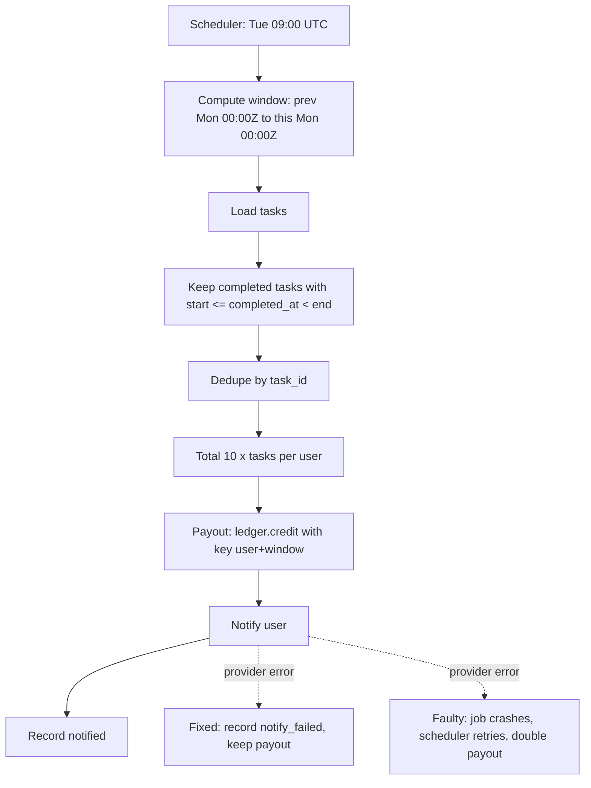

# Flow map

## Risk points
1. Window computation (timezone and boundary): TC-02, TC-03, TC-04a/b, TC-13
2. Counting (duplicates, non-qualifying): TC-05, TC-10, TC-14
3. Payout (retry, idempotency): TC-06, TC-07, TC-09
4. Notification (partial failure): TC-08, TC-11, TC-12
